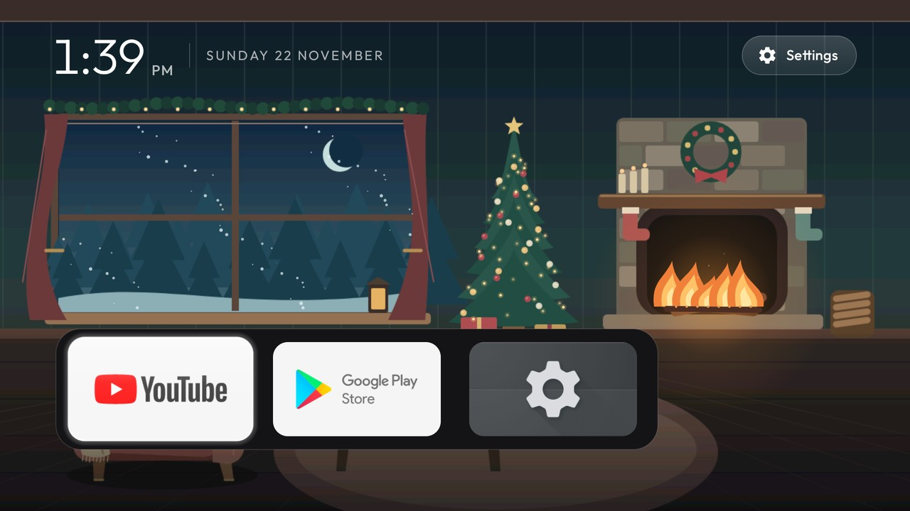

# Winter Cabin Home showcase

A CleanYourTV fork adding the animated Winter Cabin background and an in-launcher Android TV
screensaver. This is separate from the standalone Winter Cabin screensaver add-on and is not
proposed for the core launcher.

Set `"winter_cabin": true` in a theme to opt in to the backdrop. Home follows its existing
reduced-motion setting: with reduced motion enabled the illustration stays still. The independent
screensaver choice is made in Android TV settings. This fork adds no runtime permissions, remote-key
handling or dependencies, and includes no personal TV settings or viewing data.

With JDK 17 and Android SDK 34, from `launcher/` run
`./gradlew testReleaseUnitTest lintRelease assembleRelease` (`gradlew.bat` on Windows).
This uses the upstream launcher package name. **Do not install it over an existing customized
launcher or replace the configured Home app merely to preview the scene.**

This source build was tested on an Android TV 11 emulator (API 30, 1080p): Home opt-in and
motion, reduced-motion still image, D-pad input in four directions, and screensaver with Back
to exit. It also passed its release build, 331 unit tests and lint (zero errors).

An earlier version of the integration ran on Hisense SmartTV 4K FFM (Android TV 11,
firmware 00.00.01.38). The exact public build was not installed on the Hisense.
The renderer is MIT-licensed and was developed with AI coding assistance for TylerBuza.
See the [upstream discussion](https://github.com/Gathin23/cleanyourtv/discussions/4010).
